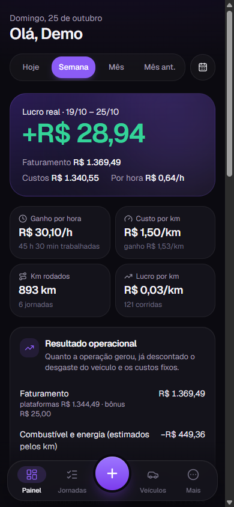
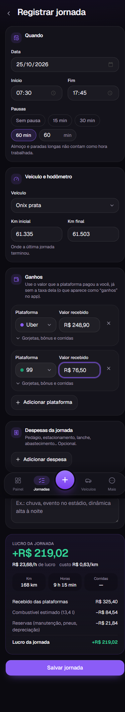
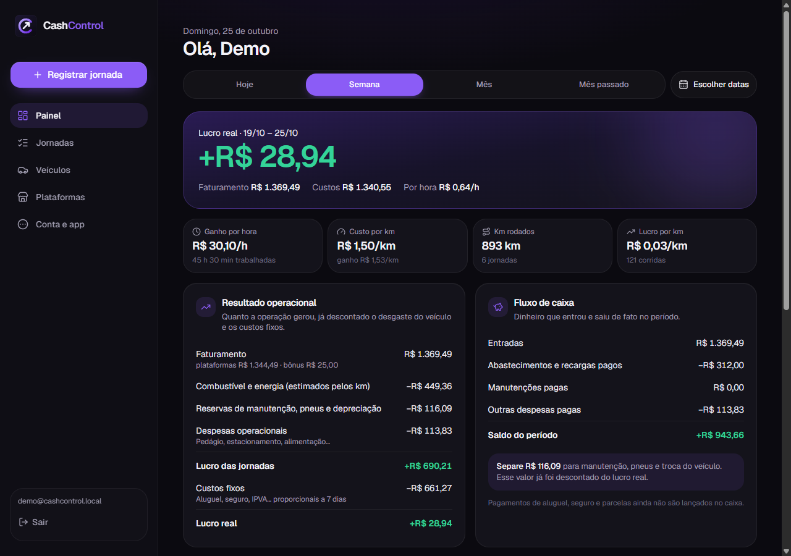

# CashControl

Planejamento e controle financeiro para motoristas de aplicativo e entregadores (Uber, 99, iFood, Rappi, mototáxi, particulares). Registra jornadas, calcula o custo por km de carros a combustão, elétricos, híbridos e motos, e mostra o **lucro real** separado do **fluxo de caixa**.

PWA instalável, mobile primeiro, escuro (preto, grafite e roxo).

**No ar:** https://cashcontrol-app.pages.dev (Cloudflare Pages + Supabase, planos gratuitos; cada envio para a `main` publica sozinho).

<p>
  
  
</p>



## Começar

```bash
npm install
npm run dev:local     # http://localhost:5180, com Supabase local (sem conta, sem Docker)
npm run seed:local    # opcional, em outro terminal: conta de demonstração com 3 semanas de dados
```

Publicação (Supabase, GitHub e Cloudflare Pages), comandos e roteiro de teste: **[docs/PUBLICACAO.md](docs/PUBLICACAO.md)**.

## Documentação

- [Arquitetura](docs/ARQUITETURA.md): camadas, pastas, modelo de dados, regras financeiras, navegação, design system.
- [Etapas](docs/ETAPAS.md): o que cada entrega inclui e os critérios de aceitação.
- [Publicação](docs/PUBLICACAO.md): rodar local, Supabase, GitHub, Cloudflare Pages.
- [Supabase local](scripts/local-supabase/README.md): servidor de desenvolvimento e contas de teste.

## Stack

React 19 · TypeScript · Vite 8 · Tailwind CSS 4 · shadcn/ui · Recharts · TanStack Query · React Hook Form + Zod · Supabase (Auth + PostgreSQL com RLS) · vite-plugin-pwa · Vitest + PGlite · Cloudflare Pages.

## Regras que o app garante

- Ganho lançado é o **líquido** que a plataforma pagou: a taxa dela nunca é descontada de novo.
- Combustível e desgaste entram no lucro pela **estimativa por km**; abastecimentos e manutenções pagos entram só no **fluxo de caixa**. Nada conta duas vezes.
- Custos fixos (aluguel, seguro, IPVA) são rateados pelos dias do período; um mês completo soma exatamente o valor mensal.
- Cada jornada guarda a "foto" dos custos do dia: mudar o preço do combustível não reescreve o passado.
- O banco recusa jornadas com horário ou hodômetro sobrepostos e isola os dados de cada usuário (RLS).

## Testes

`npm run check` roda tipos, lint e 78 testes: fórmulas financeiras, formatação pt-BR, migrations e RLS num PostgreSQL embutido, e o servidor local respondendo ao `supabase-js`.
